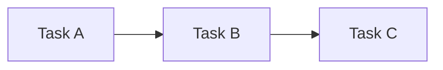
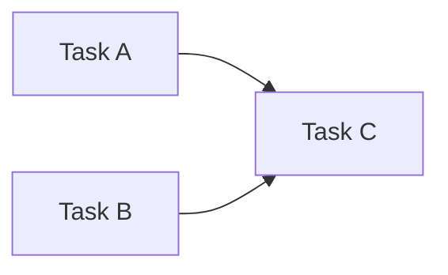
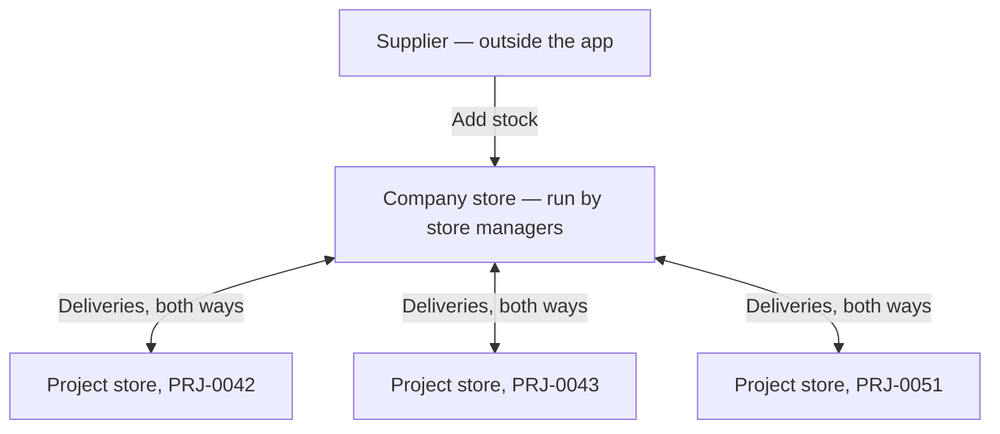
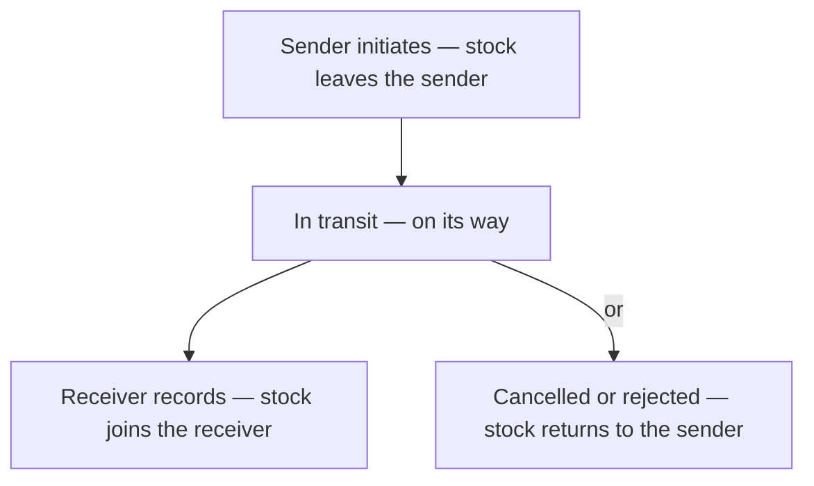

# Backend Engineer Take-Home Assignment

**TAKE-HOME ASSIGNMENT**

6 Nov 2026 · [sarvesh@seronlabs.com](mailto:sarvesh@seronlabs.com)

## Overview

Build the backend API for SiteTrack, a small construction project and materials tracker, in Dart, Go or TypeScript with Postgres as db.

- Scope: backend only. No frontend is needed; a frontend team will build screens on top of your API.
- Anything this brief does not specify is your call. Write down the decisions you made and why.

## The product

SiteTrack helps a company track its projects: the work planned on each site, and the materials stored at and moved between those sites.

- Each project has an ID such as PRJ-0042, a name, planned start and end dates, a team of members and its own store.
- A task is a piece of work on a project, such as "Pour level 2 slab". It has an ID numbered within its project, such as PRJ-0042-T-0137, and planned start and end dates.
- A task can depend on other tasks in the same project. See Task dependencies below.
- A material is a catalogue item, such as "Cement, OPC 50 kg bag". It has a name, a category and a unit.
- The company store is the company's central warehouse. Each project's project store holds the materials on that site.
- A delivery moves one or more materials between the company store and a project store, in either direction.

## Accounts and access

People register with a name, email, password and app role, log in with their email and password, and the API authenticates them with JWTs.

- A person can register, log in, log out and see their own profile.
- People should not be asked to log in again every few minutes while they are actively using the app.
- After logging out, the session they logged out of must stop working.

### App roles

Every account has one app role, chosen when registering.

| ROLE | CAN ACCESS |
| --- | --- |
| User | Only the projects they are a member of |
| Company store manager | Everything a User can, plus the company store |
| SuperAdmin | Every project and the company store, whether or not they are a member |

### Project admins

- Within a project, each member either is or is not a project admin.
- Creating a project makes you its project admin.
- A project admin can invite any other registered user, withdraw an invitation that has not been answered yet, make another member a project admin, and remove members from the project.
- An invited user sees the invitation in their notifications and accepts or rejects it. They join the project only when they accept.
- A project must always have at least one project admin.
- Members who are not project admins work with the project's tasks, store and deliveries.
- The materials catalogue is shared by everyone who is logged in.

### Data security

People must only ever reach the data their app role and project membership allow. The API checks this on every request; a frontend that hides a button is not protection.

- A person who is not a member of a project cannot read or change anything in it: its tasks, store, deliveries, members or invitations. The API answers as if the project did not exist, so it never confirms that a project ID is real.
- Every list, count, search result and report includes only what the person may see. Project and task IDs are easy to guess, so knowing one must never grant access.
- Only company store managers and SuperAdmins reach the company store and its deliveries.
- Only project admins change members, invitations and admin status. Only the invited person can accept or reject their invitation.
- Removing someone from a project, or changing their role, takes effect on their very next request, even while they are still logged in.
- Passwords are never stored or returned as plain text. A failed login never reveals whether the email is registered.

## Features

The API must let people create, view, edit and remove projects, tasks, task dependencies and materials, manage project members and invitations, and move materials between stores. The rules and screens below must also hold. Design the endpoints and response shapes as you see fit.

See the [mock UI](https://claude.ai/artifact/5akqSEM1FLHPw69jybCMTP) for how the frontend team plans to show each screen. It uses sample data and is a guide only; the rules in this brief take precedence.

### IDs

- Every project gets an ID: PRJ- and a four-digit number that counts up across the company (PRJ-0001, PRJ-0002, …).
- Every task gets an ID made of its project's ID and a number that counts up within that project. The first task in PRJ-0042 is PRJ-0042-T-0001; the first task in PRJ-0043 is PRJ-0043-T-0001.
- No two projects, and no two tasks in one project, ever get the same ID, even when many are created at the same moment.
- An ID never changes and is never reused, even after the project or task is removed.

### Task dependencies

A dependency means one task cannot start until another is done. "B depends on A" means B waits for A.

- Dependencies chain. If B depends on A, and C depends on B, then C waits for both: it cannot start until A and B are done.
- A task can depend on several tasks at once. If C depends directly on A and on B, it waits for both, whether or not A and B depend on each other.
- So C can wait on A through B (C → B → A), or on A and B side by side (C → A and C → B). Either way, C waits on every task it can reach by following dependencies.
- Dependencies only link tasks in the same project.
- A dependency that would make a task wait on itself, directly or through other tasks (A → B → A), is rejected.

#### C waits on every task it can reach by following its dependencies

An arrow points from a task to the task that waits for it.

**One after another**

C starts only after B is done; B only after A.

**Side by side**

C starts only after both A and B are done.

*Task dependencies · a chain and side by side*

### Task status

A task has one of three statuses that people set with actions, plus two flags the system works out.

| STATUS | HOW IT COMES ABOUT |
| --- | --- |
| Not started | Every new task starts here |
| In progress | The Start action, from Not started. Allowed only when every task it waits on is done |
| Done | The Mark as done action, from In progress |
| Late (derived) | Not done and its planned end date has passed, or Not started and its planned start date has passed |
| Blocked (derived) | Not done, and at least one task it waits on, directly or indirectly, is not done |

- A Reopen action moves a Done task back to In progress. It is allowed only while no task that waits on it has started.
- Any other status change is rejected.
- Late and Blocked are never set by hand. They always reflect today's date and the current state of the task's dependencies, and a task can be both at once.

### Material flow

Material enters through the company store and moves between stores only by delivery.

#### Material enters at the company store and moves only by delivery

**Each delivery**

*Material flow · company store and project stores*

1. A company store manager adds stock to the company store when materials arrive from a supplier. This is the only way new material enters SiteTrack.

2. The sender initiates a delivery: a company store manager from the company store, or a project member from their project store. A delivery lists one or more materials with quantities. The quantities leave the sender's stock straight away, and the delivery is In transit.

3. When it arrives, the receiver either records it or rejects it.

   - Recorded: the quantities join the receiver's stock, and the delivery is Delivered.
   - Rejected: the quantities return to the sender's stock, and the delivery is Rejected.

4. While a delivery is In transit, the sender can also cancel it. The quantities return to the sender's stock, and the delivery is Cancelled.

- Deliveries run both ways: company store to a project store, and a project store back to the company store. Project stores never deliver to each other.

- A store can never hold a negative quantity of a material, even when several people send deliveries from it at the same moment.

- Adding stock, initiating, recording, rejecting and cancelling each happen completely or not at all.

- A delivery is never edited once initiated.

### Company store stock status

A company store manager sets a reorder point for each material in the company store. Each material then shows one status.

| STATUS | WHEN |
| --- | --- |
| Out of stock | Quantity is 0 |
| Low stock | Quantity is above 0 and at or below the reorder point |
| Available | Quantity is above the reorder point |

## Screens

1. Log in. Email and password.

2. Register. Name, email, password and app role.

3. Notifications. Project invitations, newest first, each with Accept and Reject until answered. Every page shows how many notifications are unread.

4. Projects. Every project the person can access: ID, name, dates, whether they are its project admin, number of members, task counts by status, percentage done, number of late tasks and number of blocked tasks. Search by name or ID, show only projects with late tasks, and sort by name, start date, percentage done or late tasks.

5. Project: Tasks. Every task in the project: ID, name, dates, status, the Late and Blocked flags, the tasks it directly depends on, and how many tasks directly depend on it. Filter by status, Late, Blocked and a planned date range; search by name or ID; sort by ID, name, start date, end date or the number of tasks depending on it.

6. Task details. The task with only the status actions allowed right now. Every task it waits on, directly or indirectly, with how many steps away each one is. Every task that waits on it, shown the same way.

7. Project: Store. Every material in the project store with its quantity, unit and the date of its last delivery in or out. Search by name, filter by category, and sort by name, quantity or last delivery.

8. Project: Deliveries. The project store's incoming and outgoing deliveries, newest first: direction, status, materials, dates sent and received, and who sent and received each one. Filter by direction, status and date range. Record or reject an incoming delivery, or send material back to the company store.

9. Project: Members. Members, showing who is a project admin, and invitations not yet answered. Project admins invite people, withdraw invitations, make members project admins and remove members.

10. Company store: Stock. Every material with its quantity, unit, quantity in transit to projects, reorder point and status. Filter by status and category, search by name, and sort by name, quantity or status. Company store managers add stock and set reorder points.

11. Company store: Deliveries. Incoming and outgoing deliveries across all projects, newest first: project, direction, status, materials and dates. Filter by project, direction, status and date range. Company store managers initiate deliveries to projects, and record or reject deliveries coming back.

## Scale

Build it for a large company that has used SiteTrack for years. We will test your submission against data of at least this size:

| DATA | VOLUME |
| --- | --- |
| Users | 5,000 |
| Projects | 2,000, with up to 50 members each |
| Project invitations | 50,000 |
| Tasks | 500,000, with up to 3,000 in one project |
| Task dependencies | 1,000,000 |
| Materials | 20,000 |
| Deliveries | 400,000, holding 3,000,000 material lines |

- Every screen above should stay fast and usable at this size, on a single small server running both the API and the database.
- Include a way to fill a fresh database with realistic data at this size, so we can run your API against it.

## Ground rules

Three things are fixed; everything else is your choice.

1. The server is written in Dart, Go or TypeScript.
2. The database is PostgreSQL.
3. `docker compose up` on a clean machine starts the API and the database, ready to use, with no other setup steps.

You choose the framework, libraries, project structure, how you talk to the database, how the schema is created and changed, and how the API is shaped.

## Deliverables

Send us a link to a Git repository (public, or shared with us) containing:

- [ ] The source code, with a commit history that shows how the work progressed.
- [ ] The Docker setup that starts everything with `docker compose up`.
- [ ] The way to load data at the scale above.
- [ ] API documentation the frontend team could build from, in any format.
- [ ] A README covering how to run it, the decisions you made and why, the trade-offs you accepted, and what you would change or add with more time.

Questions, or ready to submit? Email your GitHub repository link to [sarvesh@seronlabs.com](mailto:sarvesh@seronlabs.com).
